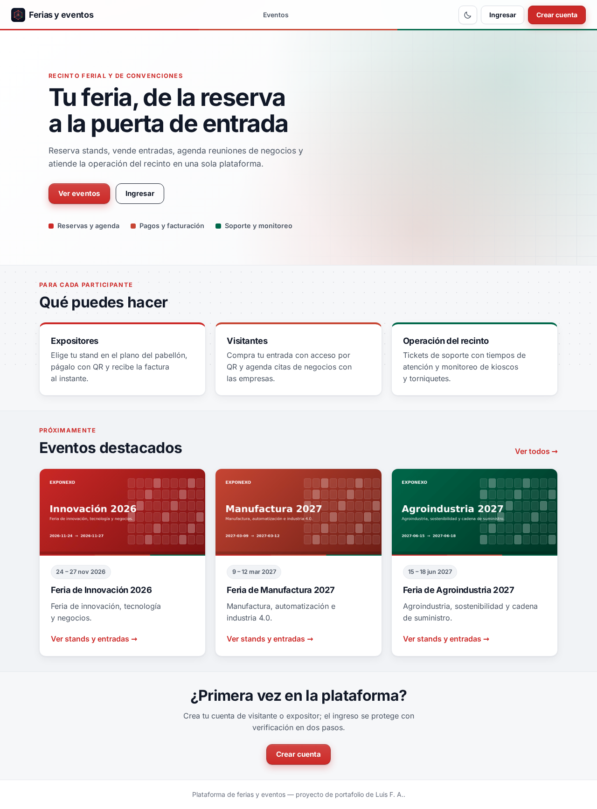
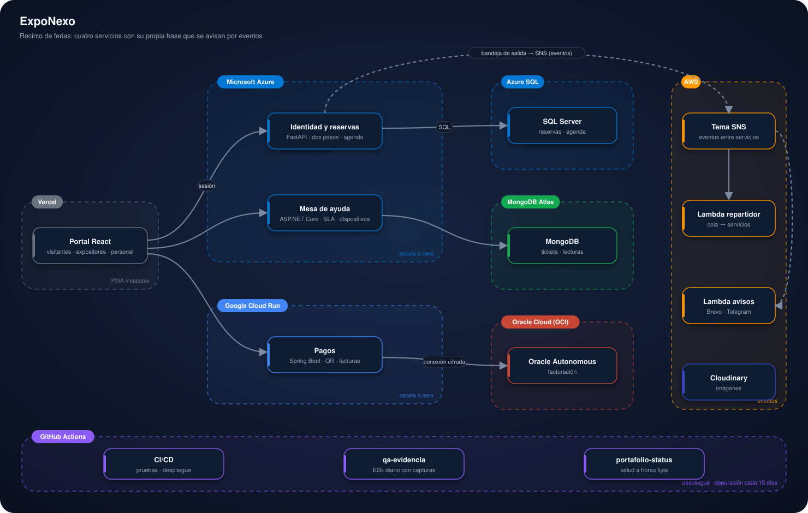

# ExpoNexo · Ferias y eventos

<p>
  <a href="https://exponexo-portal.vercel.app"></a>
  <a href="https://frontend-nine-topaz-99.vercel.app"></a>
  <a href="https://d4i3vsgw7xwmh.cloudfront.net"></a>
</p>


> 📘 **[Manual de usuario](docs/MANUAL.md)**: cómo usar cada pantalla, paso a paso y con imágenes.
> 🛠️ **[Manual de desarrollo](docs/MANUAL-DESARROLLO.md)**: cómo correr y probar el código.

## Contenido

1. [Presentación](#1-presentación)
2. [Funcionalidades](#2-funcionalidades)
3. [Arquitectura](#3-arquitectura)
4. [Estructura del proyecto](#4-estructura-del-proyecto)
5. [Instalación para pruebas](#5-instalación-para-pruebas)
6. [Autor y licencia](#6-autor-y-licencia)

---

## 1. Presentación

Plataforma integral de un recinto de ferias y eventos: los expositores reservan y pagan sus stands,
los visitantes compran su entrada y agendan citas de negocios, y el personal del recinto atiende
incidentes y vigila kioscos y torniquetes durante el evento. Son cuatro servicios en cuatro
lenguajes, cada uno con su propia base de datos, que se avisan entre sí por eventos.

<p align="center">
  
</p>

- **Qué hace:** organiza una feria de punta a punta: stands, pagos, entradas con QR, agenda de
  negocios y soporte del recinto.
- **Qué muestra:** cómo servicios independientes en Python, Java, C# y React trabajan juntos sin
  compartir base de datos.
- **Cómo probarlo:** entra a la [demo](https://exponexo-portal.vercel.app), revisa los eventos y su
  plano de stands, y crea una cuenta de visitante o expositor.

## 2. Funcionalidades

- **Expositores:** plano del pabellón con el estado de cada stand en tiempo real, reserva, pago con
  QR y factura.
- **Visitantes:** entrada con acceso por QR y agenda de citas de negocios con los expositores.
- **Personal del recinto:** tickets de soporte con tiempos de atención y monitoreo de kioscos y
  torniquetes.
- **Cuenta:** registro con confirmación del correo, ingreso en dos pasos o con llave de acceso,
  recuperación de contraseña y avisos por correo y Telegram.
- **Interfaz:** se instala como aplicación, con tema claro y oscuro; adaptable a celular, tablet y
  computador.

## 3. Arquitectura

<p align="center">
  
</p>

| Servicio | Tecnología | Qué hace |
|---|---|---|
| Portal | React 19, TypeScript y Vite | La aplicación web para todos los perfiles |
| Identidad y reservas | Python y FastAPI | Cuentas, catálogo, reservas, entradas y agenda |
| Pagos | Java 25 y Spring Boot | Órdenes, cobros con QR, facturas y reembolsos |
| Mesa de ayuda | C# y ASP.NET Core 10 | Tickets con SLA y dispositivos |
| Eventos | Python | Reparte los eventos entre servicios y envía los avisos |

Cada servicio es dueño de su base y ninguno consulta la de otro: se avisan con eventos. Todo se
prueba y se publica solo desde GitHub en cada cambio.

## 4. Estructura del proyecto

```
portal/          Portal web (README propio)
servicios/
├── identidad-reservas/   Cuentas, catálogo, reservas, entradas y agenda
├── pagos/                Órdenes, cobro con QR y facturas
├── mesa-ayuda/           Tickets con SLA y dispositivos
└── eventos/              Reparto de eventos y avisos
datos-demo/      Datos de demostración ficticios
pruebas/         Pruebas de integración de punta a punta
docs/            Manuales de usuario y de desarrollo, y diagramas
compose.yaml     Los servicios en local
```

## 5. Instalación para pruebas

Requisitos: Docker y Node.js 24 (y Python 3.14, Java 25 y .NET 10 si corres cada servicio fuera de
Docker).

```bash
docker compose up --build
cd portal && npm ci && npm run dev
```

Las variables van en el `.env` de cada carpeta, a partir de su `.env.example`, con tus propios
valores. Cada servicio también corre por separado; los comandos y sus pruebas están en su README:
[portal](portal/README.md) · [identidad](servicios/identidad-reservas/README.md) ·
[pagos](servicios/pagos/README.md) · [mesa de ayuda](servicios/mesa-ayuda/README.md) ·
[eventos](servicios/eventos/README.md). El detalle está en el
[manual de desarrollo](docs/MANUAL-DESARROLLO.md).

## 6. Autor y licencia

**Luis F. A.** · [GitHub](https://github.com/lariasca1994) · [LinkedIn](https://linkedin.com/in/lfac1)

Contacto: Telegram [@lfac6](https://t.me/lfac6) · WhatsApp [@carraian160](https://wa.me/carraian160) ·
[ariascluisf@hotmail.com](mailto:ariascluisf@hotmail.com)

Licencia: MIT.
