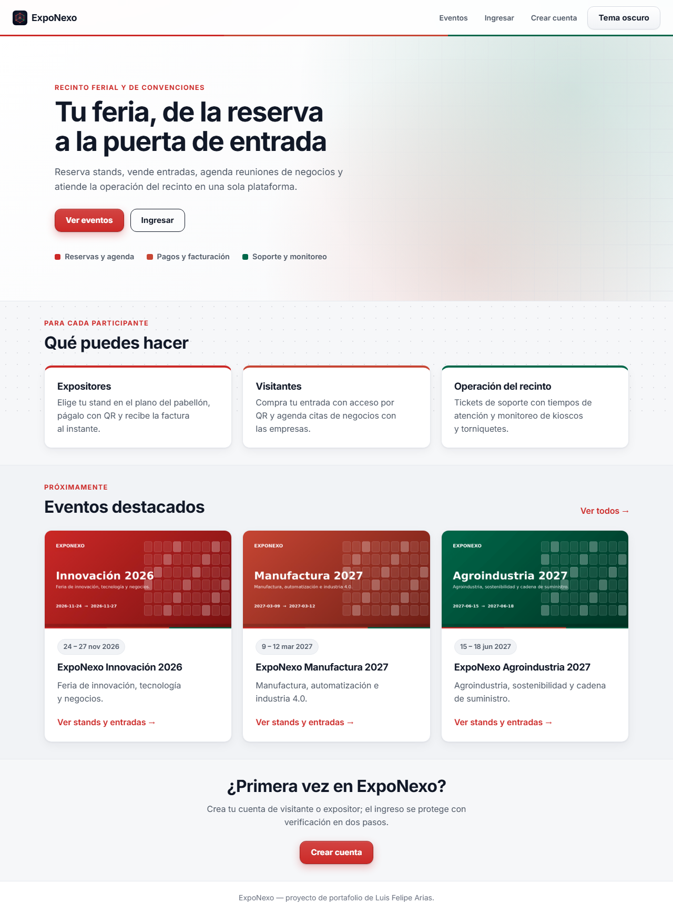
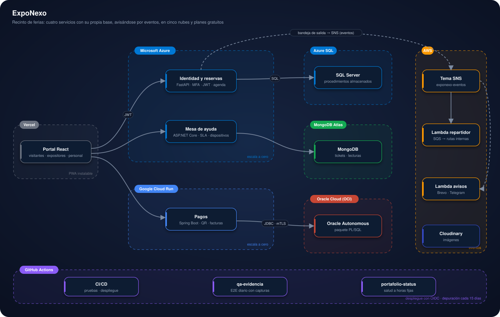

# ExpoNexo

<p>
  <a href="https://exponexo-portal.vercel.app"></a>
  <a href="https://frontend-nine-topaz-99.vercel.app"></a>
  <a href="https://d4i3vsgw7xwmh.cloudfront.net"></a>
</p>


## Contenido

1. [Presentación](#1-presentación)
2. [Estructura del proyecto](#2-estructura-del-proyecto)
3. [Arquitectura](#3-arquitectura)
4. [Plataformas y su función](#4-plataformas-y-su-función)
5. [Cómo usar la plataforma](#5-cómo-usar-la-plataforma)
6. [Instalación para pruebas](#6-instalación-para-pruebas)
7. [Autor y licencia](#7-autor-y-licencia)

---

## 1. Presentación

Plataforma integral de un recinto de ferias y eventos: los expositores reservan y pagan sus stands,
los visitantes compran su entrada y agendan citas de negocios, y el personal del recinto atiende
incidentes y vigila kioscos y torniquetes durante el evento. Son cuatro servicios en cuatro
lenguajes, cada uno con su propia base de datos, que se avisan por eventos y corren en cinco nubes
con planes gratuitos.

<p align="center">
  
</p>

### En pocas palabras

- **Qué hace:** organiza una feria de punta a punta: stands, pagos, entradas con QR, agenda de
  negocios y soporte del recinto.
- **Qué muestra:** cómo varios servicios independientes (Python, Java, C# y React) con tres motores
  de base de datos distintos trabajan juntos sin compartir base, avisándose por eventos.
- **Cómo probarlo:** entra a la [demo](https://exponexo-portal.vercel.app), revisa los eventos y su
  plano de stands, y crea una cuenta de visitante o expositor en *Registro*. Para correrlo en tu
  equipo, ve a [Instalación para pruebas](#6-instalación-para-pruebas).

### Demo en vivo

**Aplicación:** [abrir la demo en vivo](https://exponexo-portal.vercel.app)

La primera consulta del día puede tardar unos segundos: los servicios y la base de identidad se
apagan solos sin uso y despiertan con la primera visita. Mientras tanto el portal muestra su
pantalla de mantenimiento, que se recupera sola.

### Qué hace

| Para quién | Qué puede hacer |
|---|---|
| **Visitante** | Comprar su entrada con código QR de acceso, ver expositores y agendar citas de negocios sin cruces de horario. |
| **Expositor** | Elegir su stand en el plano del pabellón, pagarlo con QR, recibir la factura y atender su agenda de reuniones. |
| **Personal del recinto** | Validar entradas en la puerta, atender tickets de soporte con tiempos de atención y vigilar los dispositivos. |
| **Administrador** | Gestionar eventos, pabellones, stands y salas, y consultar el tablero de ocupación, recaudo y soporte. |

- Verificación en dos pasos obligatoria: app autenticadora, código por correo o llave de acceso.
- Bloqueo temporal ante intentos fallidos y registro de eventos de seguridad.
- QR firmados para entradas y cobros: uno alterado se rechaza.
- Avisos por correo y Telegram cuando ocurre algo importante (pago aprobado, cita aceptada, ticket
  vencido).
- Portal instalable (PWA) con tema claro y oscuro, y una paleta con un color por base de datos:
  rojo SQL Server, rojo Oracle y verde MongoDB.

### Con qué está hecho

| Capa | Tecnología |
|---|---|
| Portal | React 19, TypeScript, Vite (PWA) |
| Identidad, reservas y agenda | Python, FastAPI, SQLAlchemy, Alembic |
| Pagos | Java 25, Spring Boot 4, PL/SQL |
| Mesa de ayuda | C#, ASP.NET Core 10 |
| Eventos y avisos | Python en AWS Lambda, SNS y SQS |
| Bases de datos | SQL Server, Oracle Autonomous, MongoDB |
| Sesiones | JWT RS256 con JWKS, verificado por cada servicio |

---

## 2. Estructura del proyecto

```
.
├── portal/                     Portal web (React + Vite) — README propio
├── servicios/
│   ├── identidad-reservas/     Cuentas, MFA, catálogo, reservas, entradas y agenda (FastAPI)
│   ├── pagos/                  Órdenes, cobro con QR y facturas (Spring Boot)
│   ├── mesa-ayuda/             Tickets con SLA y dispositivos (ASP.NET Core)
│   └── eventos/                Repartidor de eventos y avisos (Lambda)
├── datos-demo/                 Datos e imágenes de demostración generados automáticamente
├── infra/                      Scripts que crean los recursos en cada nube y la depuración
├── pruebas/                    Pruebas de integración de punta a punta
├── docs/                       Manual, arquitectura, contratos, modelo de datos y decisiones
│   └── img/manual/             Capturas del manual (se regeneran solas)
├── .github/workflows/          Pruebas, despliegue, capturas y depuración quincenal
├── compose.yaml                Los tres servicios en local
└── README.md                   Este archivo
```

---

## 3. Arquitectura

<p align="center">
  
</p>

- Cada servicio es dueño de su base y nadie consulta la base de otro: se avisan con eventos. Cada
  escritura guarda su evento en una **bandeja de salida** dentro de la misma transacción y lo
  publica en el tema SNS; el repartidor lo entrega a las rutas internas de los otros servicios y
  otra Lambda envía los avisos.
- El portal guarda la sesión solo en memoria; cada servicio verifica el JWT con las llaves públicas
  de identidad.
- **Costo cero:** todo usa planes gratuitos y escala a cero. La base de identidad se pausa sola
  porque nada la consulta sin uso (la portada no llama a ningún servicio y no hay sondeos
  periódicos), y cada 15 días se depura lo vencido para no acumular espacio.

Detalle técnico: [arquitectura](docs/ARQUITECTURA.md) · [modelo de datos](docs/MODELO-DE-DATOS.md) ·
[contratos de API](docs/CONTRATOS-API.md) · [eventos](docs/EVENTOS.md) ·
[decisiones (ADR)](docs/DECISIONES.md).

---

## 4. Plataformas y su función

| Plataforma | Función en el proyecto |
|---|---|
|  | Publica el portal en cada push a `main`. |
|  | Container Apps ejecuta identidad y mesa de ayuda (escalan a cero); Azure SQL sin servidor guarda cuentas, catálogo, reservas, entradas y agenda, y se pausa sola. |
|  | Ejecuta el servicio de pagos y escala a cero. |
|  | Oracle Autonomous guarda órdenes, cobros y facturas, con la lógica en un paquete PL/SQL. |
|  | Guarda tickets, dispositivos y lecturas (estas vencen solas a los 15 días). |
|  | SNS reparte los eventos a una cola SQS por función; dos Lambdas los entregan y envían los avisos. |
|  | Guarda las portadas de eventos, logos y planos generados automáticamente. |
|   | Envían los códigos de verificación y los avisos. |
|  | Prueba y despliega cada servicio con OIDC, regenera las capturas del manual y depura cada 15 días. |
|  | Prueba la demo automáticamente cada día hábil y publica la evidencia. |

---

## 5. Cómo usar la plataforma

El paso a paso completo, campo por campo y con capturas, está en el
**[manual de usuario](docs/MANUAL.md)**. En resumen:

1. **Eventos:** desde la portada pulsa **Ver eventos** y luego **Ver plano de stands** para ver el
   estado de cada stand (verde disponible, naranja reservado, azul pagado).
2. **Crear cuenta:** en **Registro** escribe nombre, correo, tipo de participación (visitante o
   expositor) y contraseña; confirma el código que llega al correo.
3. **Ingresar:** correo y contraseña, y luego el segundo paso (app, correo o llave de acceso).
4. **Expositor:** elige un stand, pulsa **Reservar este stand** y en **Mis Reservas** pulsa
   **Pagar con QR**; la factura aparece en **Facturas**.
5. **Visitante:** en **Mis Entradas → Adquirir nueva entrada** paga y activa tu QR; en
   **Agenda B2B** pide citas con los expositores.
6. **Personal:** **Validar QR en puerta**, **Mesa de ayuda** y **Dispositivos**.
7. **Administrador:** **Catálogo** y **Tablero**.

### Si un servicio no responde

Si un servicio responde 502, 503 o 504, o no responde, el portal muestra la pantalla
**Estamos preparando el recinto** con los colores del proyecto en lugar de un error. Cada 30
segundos vuelve a consultar la salud del servicio y regresa sola cuando responde; no reintenta
acciones del usuario, para no duplicarlas.

---

## 6. Instalación para pruebas

Requisitos: Docker, Node.js 24, Python 3.14, Java 25 y .NET 10 (estos tres solo si corres cada
servicio fuera de Docker).

```bash
docker compose up --build              # identidad :8001, pagos :8002, mesa de ayuda :8003
cd portal && npm ci && npm run dev     # portal en http://localhost:5173
```

Las variables van en el `.env` de cada carpeta, a partir de su `.env.example`. Cada servicio
también corre por separado; los comandos están en su README:
[portal](portal/README.md) · [identidad](servicios/identidad-reservas/README.md) ·
[pagos](servicios/pagos/README.md) · [mesa de ayuda](servicios/mesa-ayuda/README.md) ·
[eventos](servicios/eventos/README.md).

### Pruebas

| Componente | Comando | Qué cubre |
|---|---|---|
| Identidad | `python -m pytest pruebas` | Registro, MFA, reservas concurrentes, QR de entradas, agenda, depuración |
| Pagos | `./mvnw verify` | Idempotencia, firma del QR, facturación, wallet |
| Mesa de ayuda | `dotnet test` | SLA, JWT verificado, formato de MongoDB |
| Eventos | `python -m pytest pruebas` | Reparto de eventos, idempotencia y avisos |
| Integración | `python -m pytest pruebas/test_e2e_integration.py` | Registro, reserva, pago y acceso (también contra SQL Server real en CI) |
| Portal | `npm test && npm run build` | Sesión, mantenimiento, tipos y empaquetado |

### Despliegue

Todo sale de GitHub: cada push a `main` prueba y despliega el servicio que cambió. La configuración
de producción vive en el entorno `produccion` de GitHub y los workflows la entregan a cada nube
([workflows](.github/workflows/README.md) · [infra](infra/README.md) ·
[manual de desarrollo](docs/MANUAL-DESARROLLO.md)).

- **Datos de demostración:** el workflow *Poblar datos de demostración* genera eventos, empresas,
  stands e imágenes (subidas a Cloudinary), los valida en bases temporales y luego los carga
  ([datos-demo](datos-demo/README.md)).
- **Capturas automáticas:** cada cambio del portal regenera las imágenes del manual contra
  producción (`capturas-manual.yml`).
- **Depuración cada 15 días:** los días 1 y 16 de cada mes `depuracion.yml` borra de las tres bases
  los registros operativos vencidos y de GitHub las imágenes, cachés, artefactos y ejecuciones
  viejas, para no acumular espacio que pueda generar costo.

---

## 7. Autor y licencia

> 📘 **[Manual de usuario](docs/MANUAL.md)**: cómo usar la plataforma campo por campo, qué datos se ingresan y qué garantiza en seguridad.

**Luis Felipe Arias Carriazo**
[GitHub](https://github.com/lariasca1994) · [LinkedIn](https://linkedin.com/in/lfac1)

Licencia: MIT.
