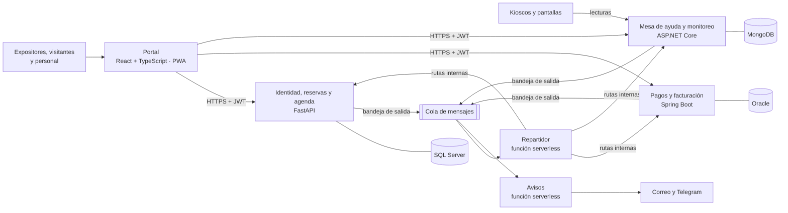

# Arquitectura de ExpoNexo

## 1. Vista general

| Servicio | Tecnología/base | Plataforma objetivo | Automatización configurada en el repositorio |
|---|---|---|---|
| Portal | React + TypeScript (Vite), PWA | Vercel previsto | No se encontró workflow de Actions propio. |
| Identidad, reservas y agenda | Python · FastAPI · SQL Server | Azure Container Apps previsto | Pruebas con SQLite y publicación de imagen en GHCR; el workflow no despliega a Azure. |
| Pagos y facturación | Java · Spring Boot · Oracle | Cloud Run | El workflow configura publicación en Google Artifact Registry y despliegue. |
| Mesa de ayuda y monitoreo | C# · ASP.NET Core · MongoDB | Azure Container Apps previsto | Pruebas xUnit y publicación de imagen en GHCR; el workflow no despliega a Azure. |
| Eventos entre servicios | Cola de mensajes + funciones Python | AWS Lambda | El workflow configura empaquetado y despliegue Lambda. |
| Calidad | pytest, JUnit, xUnit, Actions | — | Los workflows no prueban todas las bases de datos reales ni ejecutan un conjunto común de pruebas de contrato. |

## 2. Principios (por qué está hecho así)

1. **Una base por servicio.** Ningún servicio lee ni escribe la base de otro. Si necesita un dato
   ajeno, lo pide por API o lo recibe por un evento. *Estudia: «database per service».*
2. **Un solo emisor de identidad.** Solo identidad-reservas firma tokens (RS256). Los demás
   servicios los **verifican** con la clave pública que publica en su JWKS. *Estudia: «JWKS»,
   «resource server».*
3. **Comunicación síncrona solo desde el portal.** El portal llama a cada servicio por HTTPS. Entre
   servicios, la comunicación es por **eventos** a través de la cola; así, si pagos está caído,
   reservas sigue funcionando. *Estudia: «choreography vs orchestration».*
4. **Bandeja de salida (outbox).** El patrón objetivo guarda el evento en la misma transacción
   que el cambio de negocio y lo publica después. Verifica cada implementación antes de afirmar
   que todos los productores lo hacen atómicamente. *Estudia: «transactional outbox».*
5. **Consumidores idempotentes.** La cola entrega «al menos una vez»: el mismo mensaje puede
   llegar dos veces. Cada servicio registra los `id` de eventos ya procesados. *Estudia:
   «idempotent consumer».*
6. **Rutas internas protegidas.** Las rutas que llama el repartidor no son públicas: exigen un
   token de servicio (no de persona). *Estudia: «OAuth2 client credentials», «service-to-service
   authentication».*
7. **Identificador de correlación.** Cada petición lleva un identificador (`X-Correlation-Id`) que
   viaja por todos los servicios y eventos, para seguir una operación de punta a punta en los
   logs. *Estudia: «correlation id microservices».*
8. **Costo cero y escala a cero.** Solo se usan planes gratuitos; un recurso sin opción gratuita
   no entra al proyecto. Los servicios se duermen sin tráfico y el portal muestra una pantalla
   de espera mientras despiertan. Registros, logs e imágenes viejas se depuran para no salir de
   las capas gratuitas.

## 2.1 Convenciones

- ADR-012: clases, funciones y variables en inglés; tablas, columnas, procedimientos, rutas,
  propiedades JSON, tipos de evento y variables de entorno en español.
- ADR-013: UUID generado por la aplicación y guardado como texto de 36 caracteres en SQL Server,
  Oracle y MongoDB.
- ADR-014: cuerpos JSON en `snake_case` en todos los servicios.
- Identidad y Mesa de ayuda publican imágenes a GHCR desde Actions y actualizan su Azure
  Container App con esa imagen. Pagos usa Google Artifact Registry dentro de su capa gratuita.
  Ver [DECISIONES.md](DECISIONES.md) ADR-017.

## 3. Flujos principales

### 3.1 Reserva y pago de un stand

1. El portal pide a **identidad-reservas** reservar el stand. Se crea la reserva pendiente y un
   evento en su bandeja de salida. `reserva.creada` es el nombre legado documentado; el objetivo
   es `reservation.created`.
2. El portal pide a **pagos** crear la orden para esa reserva. Pagos consulta el monto a reservas
   (o lo recibe en el evento) — nunca confía en el monto que manda el navegador.
3. El expositor paga el QR. Pagos aprueba la orden, crea la factura y guarda el evento legado
   `pago.aprobado` (objetivo `payment.approved`).
4. El **repartidor** recibe el evento y llama a la ruta interna de reservas, que marca la
   reserva `pagada`.
5. **Avisos** envía la confirmación y la factura por correo.

### 3.2 Cita de negocios

1. El visitante ve la disponibilidad del expositor y propone una franja.
2. El expositor acepta: se guarda la cita y el evento legado `cita.aceptada` (objetivo
   `appointment.accepted`).
3. **Avisos** envía el correo a ambos.

### 3.3 Kiosco caído

1. Cada kiosco envía lecturas a **mesa-ayuda** cada minuto.
2. Un proceso en segundo plano detecta que uno no reporta hace X minutos.
3. Abre un ticket y una alerta, y guarda el evento legado `dispositivo.caido` (objetivo
   `device.offline`).
4. **Avisos** manda el mensaje de Telegram al personal.

## 4. Seguridad (resumen de diseño)

- Verificación en dos pasos obligatoria (app autenticadora o código por correo) y llaves de acceso.
- Tokens de acceso cortos y de refresco revocables.
- Roles: `visitante`, `expositor`, `personal` y `administrador`; las rutas internas solo aceptan
  el token de servicio (ver [CONTRATOS-API.md](CONTRATOS-API.md)).
- Secretos fuera del repositorio; en producción, solo como secretos de GitHub y de cada nube.
- Despliegue sin claves guardadas (OIDC).

## 5. Puertos locales sugeridos

| Servicio | Puerto local |
|---|---|
| Portal | 5173 |
| Identidad, reservas y agenda | 8001 |
| Pagos y facturación | 8002 |
| Mesa de ayuda y monitoreo | 8003 |
