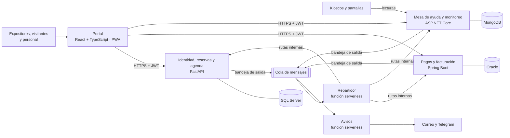

# Arquitectura de ExpoNexo

## 1. Vista general

| Servicio | Tecnología | Base | Dónde se despliega |
|---|---|---|---|
| Portal | React + TypeScript (Vite), PWA | — | Vercel |
| Identidad, reservas y agenda | Python · FastAPI | SQL Server (Azure SQL) | Azure Container Apps |
| Pagos y facturación | Java · Spring Boot | Oracle Autonomous | Cloud Run |
| Mesa de ayuda y monitoreo | C# · ASP.NET Core | MongoDB Atlas | Azure Container Apps |
| Eventos entre servicios | Cola de mensajes + funciones en Python | — | AWS |
| Calidad y operación | Playwright, contratos OpenAPI, pytest, JUnit, xUnit, GitHub Actions | — | qa-evidencia y portafolio-status |

## 2. Principios (por qué está hecho así)

1. **Una base por servicio.** Ningún servicio lee ni escribe la base de otro. Si necesita un dato
   ajeno, lo pide por API o lo recibe por un evento. *Estudia: «database per service».*
2. **Un solo emisor de identidad.** Solo identidad-reservas firma tokens (RS256). Los demás
   servicios los **verifican** con la clave pública que publica en su JWKS. *Estudia: «JWKS»,
   «resource server».*
3. **Comunicación síncrona solo desde el portal.** El portal llama a cada servicio por HTTPS. Entre
   servicios, la comunicación es por **eventos** a través de la cola; así, si pagos está caído,
   reservas sigue funcionando. *Estudia: «choreography vs orchestration».*
4. **Bandeja de salida (outbox).** Un servicio guarda el evento en su propia base en la misma
   transacción que el cambio de negocio, y un proceso aparte lo publica en la cola. Así nunca se
   pierde un evento ni se publica uno de un cambio que no se guardó. *Estudia: «transactional
   outbox».*
5. **Consumidores idempotentes.** La cola entrega «al menos una vez»: el mismo mensaje puede
   llegar dos veces. Cada servicio registra los `id` de eventos ya procesados. *Estudia:
   «idempotent consumer».*
6. **Rutas internas protegidas.** Las rutas que llama el repartidor no son públicas: exigen un
   token de servicio (no de persona). *Estudia: «OAuth2 client credentials», «service-to-service
   authentication».*
7. **Identificador de correlación.** Cada petición lleva un identificador (`X-Correlation-Id`) que
   viaja por todos los servicios y eventos, para seguir una operación de punta a punta en los
   logs. *Estudia: «correlation id microservices».*
8. **Costo cero y escala a cero.** Todo en planes gratuitos; los servicios se apagan sin tráfico y
   el portal muestra una pantalla de espera mientras despiertan.

## 3. Flujos principales

### 3.1 Reserva y pago de un stand

1. El portal pide a **identidad-reservas** reservar el stand. Se crea la reserva
   `pendiente_pago` y el evento `reserva.creada` en su bandeja de salida.
2. El portal pide a **pagos** crear la orden para esa reserva. Pagos consulta el monto a reservas
   (o lo recibe en el evento) — nunca confía en el monto que manda el navegador.
3. El expositor paga el QR. Pagos aprueba la orden, crea la factura y guarda `pago.aprobado`.
4. El **repartidor** recibe `pago.aprobado` y llama a la ruta interna de reservas, que marca la
   reserva `pagada`.
5. **Avisos** envía la confirmación y la factura por correo.

### 3.2 Cita de negocios

1. El visitante ve la disponibilidad del expositor y propone una franja.
2. El expositor acepta: se guarda la cita y `cita.aceptada`.
3. **Avisos** envía el correo a ambos.

### 3.3 Kiosco caído

1. Cada kiosco envía lecturas a **mesa-ayuda** cada minuto.
2. Un proceso en segundo plano detecta que uno no reporta hace X minutos.
3. Abre un ticket y una alerta, y guarda `dispositivo.caido`.
4. **Avisos** manda el mensaje de Telegram al personal.

## 4. Seguridad (resumen de diseño)

- Verificación en dos pasos obligatoria (app autenticadora o código por correo) y llaves de acceso.
- Tokens de acceso cortos y de refresco revocables.
- Roles: `visitante`, `expositor`, `personal`, `administrador`.
- Secretos fuera del repositorio; en producción, solo como secretos de GitHub y de cada nube.
- Despliegue sin claves guardadas (OIDC).

## 5. Puertos locales sugeridos

| Servicio | Puerto local |
|---|---|
| Portal | 5173 |
| Identidad, reservas y agenda | 8001 |
| Pagos y facturación | 8002 |
| Mesa de ayuda y monitoreo | 8003 |
