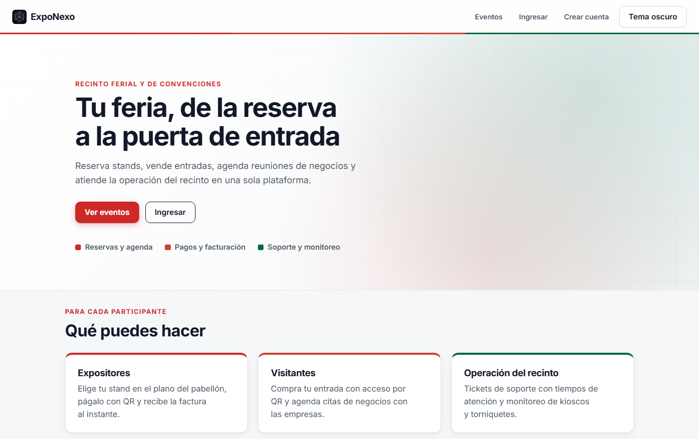
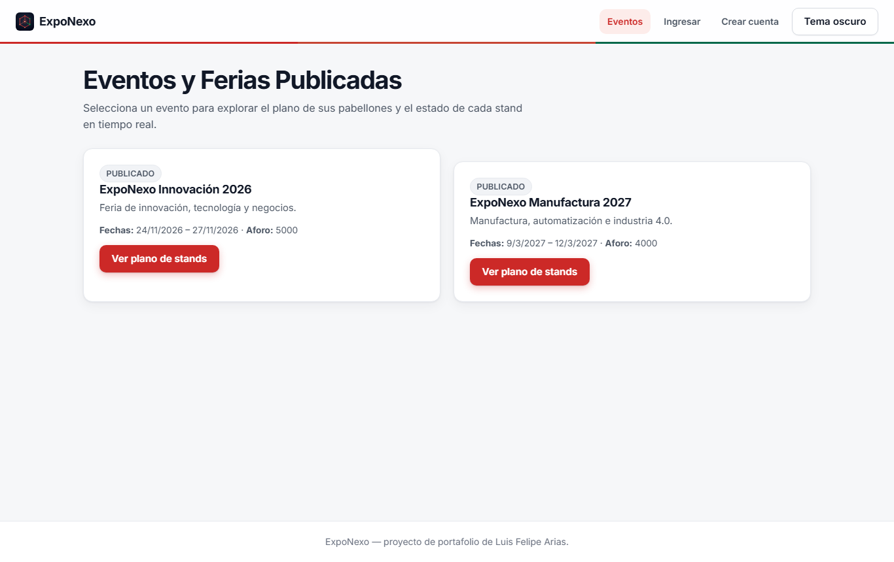
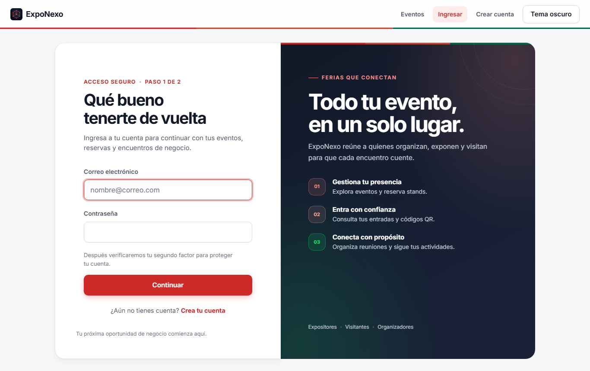

# Manual de usuario

ExpoNexo se usa desde el navegador en https://exponexo-portal.vercel.app y se puede instalar como
aplicación en el celular o el computador (opción *Instalar* o *Agregar a la pantalla de inicio*
del navegador). El botón **Tema oscuro / Tema claro** del encabezado cambia los colores y se
recuerda en las siguientes visitas.

> La primera consulta del día puede tardar unos segundos: los servicios se apagan solos cuando
> nadie los usa y despiertan con la primera visita.

## 1. Portada y catálogo

La portada presenta el recinto, lo que puede hacer cada participante y los próximos eventos.
**Ver eventos** abre el catálogo con los eventos publicados, sus fechas y precio de entrada.

## 2. Crear cuenta e ingresar

1. En **Crear cuenta** escribe tu nombre, correo y contraseña (mínimo 10 caracteres, con
   mayúscula, minúscula, número y símbolo) y elige si participas como **visitante** o
   **expositor**.
2. Confirma tu correo con el código que llega a tu bandeja.
3. En **Ingresar** escribe tu correo y contraseña; después confirma el segundo paso con tu app
   autenticadora, el código por correo o tu llave de acceso.

En **Seguridad** (con sesión iniciada) puedes activar la app autenticadora, generar códigos de
respaldo y registrar llaves de acceso del dispositivo.

## 3. Expositores: reservar y pagar un stand

1. En **Eventos**, elige un evento y abre **Ver stands**: el plano muestra cada stand por
   pabellón con su tipo (básico, esquinero o isla), área, precio y disponibilidad.
2. Selecciona un stand libre y confirma la reserva. Tienes un tiempo limitado para pagarla; si
   vence, el stand vuelve a quedar disponible.
3. En **Mis reservas** elige **Pagar**: se genera un código QR de cobro con vigencia corta.
   Al aprobarse el pago la reserva queda pagada y la factura aparece en **Facturas**.

## 4. Visitantes: entradas y agenda de negocios

- En el catálogo compra tu entrada (general, negocios o prensa). Pagada, aparece en
  **Mis entradas** con su código QR de acceso.
- En **Agenda B2B** busca expositores del evento, revisa sus horarios libres y pide una cita.
  Cuando el expositor la acepta, el sistema asigna una sala libre y avisa a ambos.

## 5. Personal del recinto

- **Validar QR**: lee el código de la entrada en la puerta. Una entrada usada o alterada se
  rechaza.
- **Mesa de ayuda**: registra y atiende tickets (red, eléctrico, mobiliario, acceso,
  dispositivos). Cada prioridad tiene un tiempo de atención; un ticket vencido se escala.
- **Dispositivos**: estado de kioscos, torniquetes y pantallas; si uno deja de reportar, se abre
  un ticket automáticamente.

## 6. Administración

- **Catálogo**: crea y edita eventos, pabellones, stands y salas.
- **Tablero**: ocupación de stands, recaudo, entradas vendidas y estado del soporte.

## Avisos

Las reservas, pagos, entradas y citas generan avisos por correo; los incidentes críticos del
recinto llegan al canal de Telegram del personal.
