# 📘 Manual de usuario · ExpoNexo (Ferias y eventos)

## 1. Portada

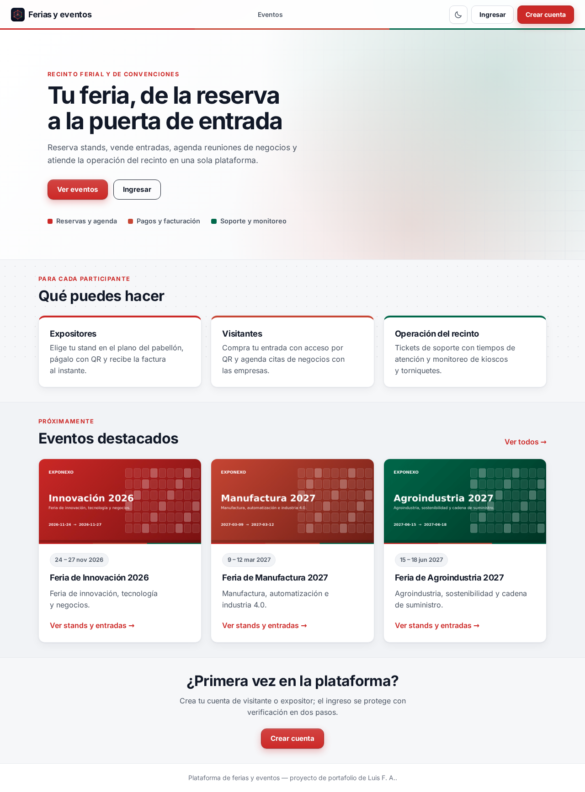

| | |
|---|---|
| **Producto** | ExpoNexo · Ferias y eventos |
| **Documento** | Manual de usuario |
| **Versión** | 2.0 · noviembre de 2026 |
| **Dirigido a** | Visitantes, expositores y personal de un recinto de ferias |
| **Dirección** | [ExpoNexo](https://exponexo-portal.vercel.app) |
| **Autor** | Luis F. A. |

## Contenido

1. [Portada](#1-portada)
2. [Introducción](#2-introducción)
3. [Objetivo](#3-objetivo)
4. [Alcance](#4-alcance)
5. [Acceso al sistema](#5-acceso-al-sistema)
6. [Pantalla principal](#6-pantalla-principal)
7. [Navegación](#7-navegación)
8. [Funcionalidades](#8-funcionalidades)
9. [Gestión de perfil](#9-gestión-de-perfil)
10. [Mensajes frecuentes](#10-mensajes-frecuentes)
11. [Preguntas frecuentes](#11-preguntas-frecuentes)
12. [Glosario](#12-glosario)

---

## 2. Introducción

**ExpoNexo** reúne en una sola plataforma lo que pasa en un recinto de ferias: los expositores
reservan y pagan sus stands, los visitantes compran su entrada y agendan citas de negocios, y el
personal del recinto atiende el soporte y vigila los dispositivos durante el evento.

Este manual explica cada pantalla, paso a paso y con imágenes.

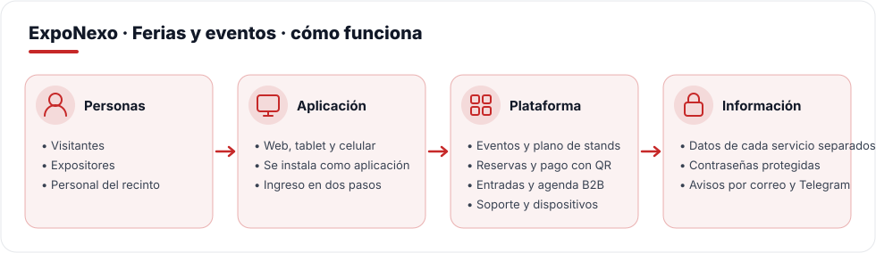

## 3. Objetivo

Que cualquier persona pueda, sin conocimientos técnicos:

- Consultar los eventos y el plano de stands de cada feria.
- Crear su cuenta e ingresar de forma segura.
- Reservar y pagar un stand (expositores) o comprar su entrada y agendar citas (visitantes).

## 4. Alcance

**Incluye:** catálogo de eventos, plano de stands en tiempo real, reservas y pago con QR, facturas,
entradas con QR, agenda de negocios, mesa de ayuda y monitoreo de dispositivos para el personal, y
uso en celular, tablet y computador.

**No incluye:** pagos con dinero real: los cobros son de demostración.

**Qué necesitas:** un navegador actualizado y conexión a internet. Para reservar o comprar, un
correo propio y una app autenticadora en el celular (o acceso a tu correo para recibir códigos).

## 5. Acceso al sistema

### 5.1 Crear una cuenta

Pulsa **Crear cuenta**.

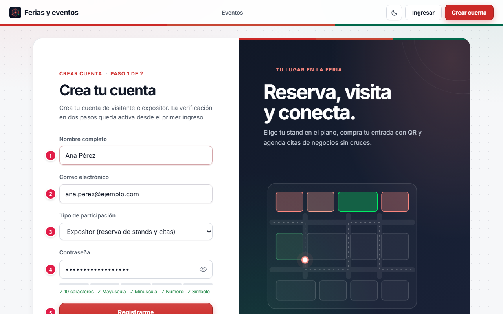

| # | Campo | Qué escribir |
|:-:|---|---|
| 1 | Nombre completo | Tu nombre |
| 2 | Correo electrónico | El correo con el que vas a entrar |
| 3 | Tipo de participación | **Visitante** o **Expositor** |
| 4 | Contraseña | Mínimo 10 caracteres, con mayúscula, minúscula, número y símbolo |
| 5 | Registrarme | Crea la cuenta y envía un código a tu correo para confirmarlo |

### 5.2 Iniciar sesión

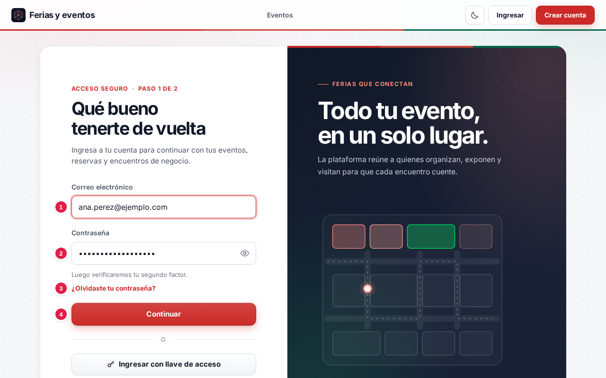

| # | Elemento | Qué hace |
|:-:|---|---|
| 1 | Correo electrónico | El correo de tu cuenta |
| 2 | Contraseña | Tu contraseña (el ojo la muestra u oculta) |
| 3 | ¿Olvidaste tu contraseña? | Abre la recuperación de contraseña (5.4) |
| 4 | Continuar | Pasa al segundo paso de la verificación |

**Ingresar con llave de acceso** te deja entrar con la huella, el rostro o el PIN del dispositivo,
si ya registraste una llave en **Mi cuenta**.

### 5.3 Verificación en dos pasos

Después de la contraseña escribes el código de 6 dígitos de tu app autenticadora o el que llega a tu
correo (también sirve un código de respaldo). Con la app, un círculo muestra cuándo cambia el
código; el candado se abre cuando el código es correcto.

### 5.4 Recuperar la contraseña

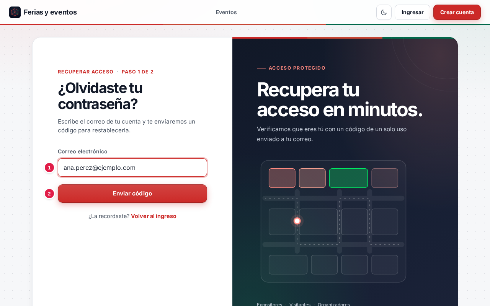

| # | Elemento | Qué hace |
|:-:|---|---|
| 1 | Correo electrónico | El correo de tu cuenta |
| 2 | Enviar código | Envía un código de un solo uso a tu correo |

En el segundo paso escribes el código, la contraseña nueva y su confirmación. Al restablecerla se
cierran todas tus sesiones y te llega un aviso por correo y Telegram.

## 6. Pantalla principal

**Eventos** muestra las ferias publicadas, con sus fechas, su aforo y el acceso a su plano de
stands.

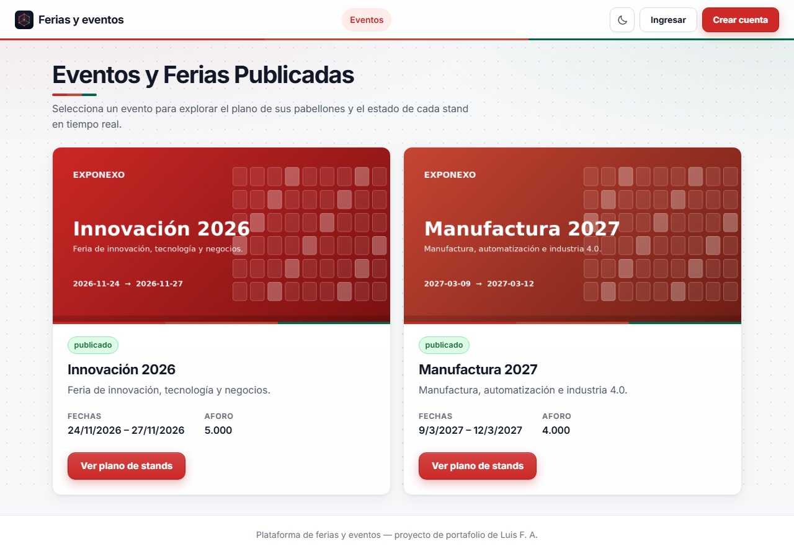

## 7. Navegación

Sin sesión, arriba están **Eventos**, el cambio de tema, **Ingresar** y **Crear cuenta**. Con la
sesión abierta, el menú va a la izquierda (**Compactar menú** deja solo los íconos); en el celular es
una barra abajo y **Más** abre las opciones que no caben.

| Tablet en vertical | Celular |
|:-:|:-:|
| 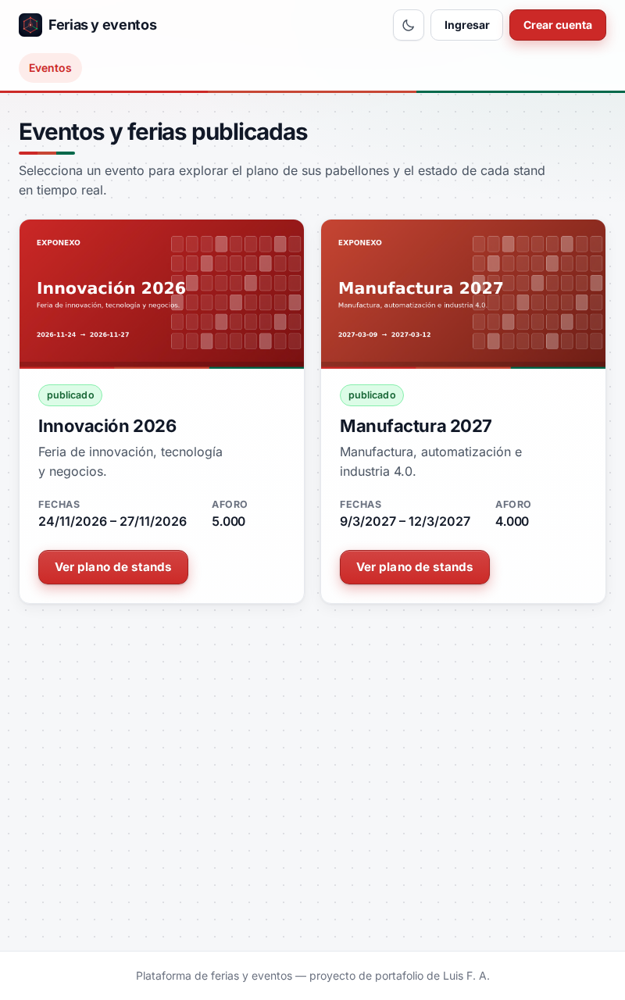 | 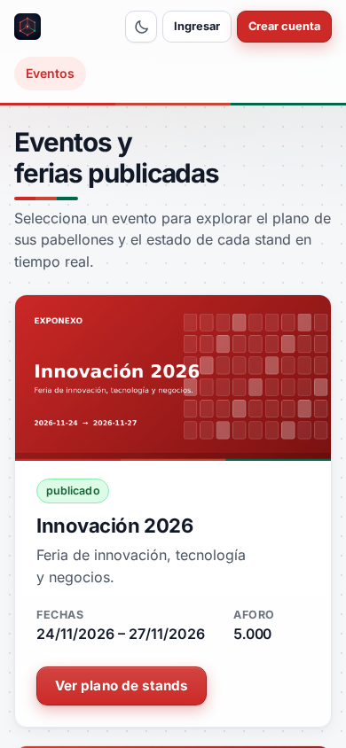 |

El botón con la luna o el sol cambia entre tema claro y oscuro, y se recuerda:

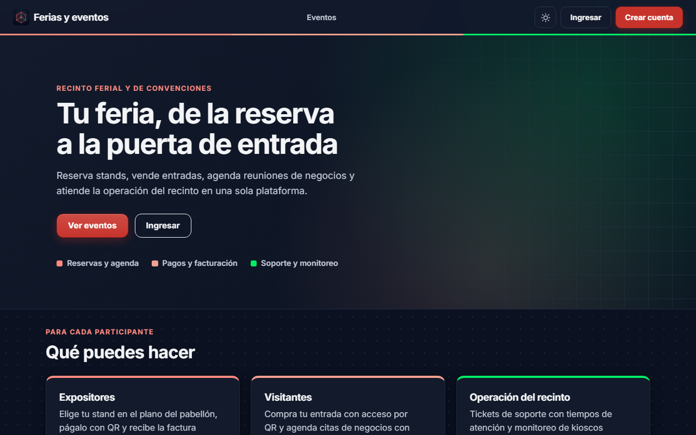

## 8. Funcionalidades

### 8.1 Crear: reservar un stand o comprar una entrada

**Expositores:** en el plano de stands elige uno disponible y pulsa **Reservar este stand**. En
**Mis Reservas** pulsa **Pagar con QR**: se genera un QR de cobro con vigencia corta; al aprobarse,
la reserva queda pagada y la factura aparece en **Facturas**.

**Visitantes:** en **Mis Entradas → Adquirir nueva entrada** eliges el evento y el tipo, y pulsas
**Pagar y activar QR**; ya pagada, aparece con su QR de acceso. En **Agenda B2B** pides una cita a un
expositor; cuando la acepta, el sistema asigna una sala libre y avisa a ambos.

### 8.2 Consultar: plano de stands

En **Eventos**, **Ver plano de stands** abre el plano del pabellón. Los colores muestran el estado
de cada stand: **verde** disponible, **naranja** reservado pendiente de pago y **azul** pagado. Al
elegir uno ves su código, tipo, área, posición y precio.

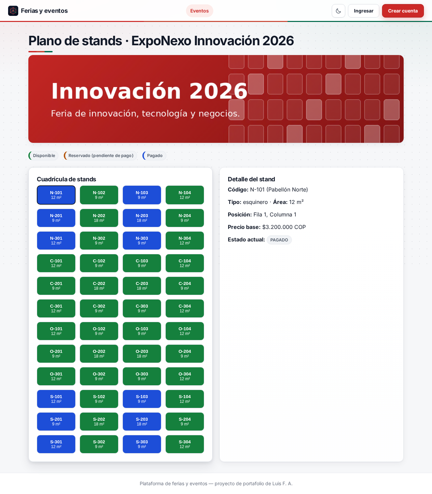

### 8.3 Modificar: reservas, citas y tickets

- **Mis Reservas:** paga o cancela tus reservas; una reserva sin pagar vence y el stand vuelve a
  quedar disponible.
- **Agenda B2B:** el expositor acepta o rechaza las citas que recibe.
- **Personal del recinto:** en **Mesa de ayuda** crea y atiende tickets (cada prioridad tiene su
  tiempo de atención y un ticket vencido se escala) y en **Validar QR en puerta** lee las entradas
  (una entrada usada o alterada se rechaza).

### 8.4 Reportar: facturas y tablero

- **Facturas:** las facturas de tus pagos.
- **Tablero** (administración): ocupación de stands, recaudo, entradas vendidas y estado del
  soporte.
- **Dispositivos** (personal): estado de kioscos, torniquetes y pantallas; si uno deja de reportar,
  se abre un ticket solo.

## 9. Gestión de perfil

Con la sesión iniciada, pulsa tu nombre en la esquina superior derecha para abrir **Mi cuenta**:

- **Datos:** nombre, rol, correo, Telegram y estado de la verificación en dos pasos.
- **Cambiar contraseña:** pide la actual y la nueva; cierra tus sesiones en otros dispositivos.
- **Avisos por Telegram:** pulsa **Vincular Telegram**, luego **Iniciar** en el bot y vuelve con
  **Ya pulsé Iniciar**.
- **App autenticadora, código por correo y códigos de respaldo:** elige el método por defecto.
- **Llaves de acceso** y **sesiones activas**.

## 10. Mensajes frecuentes

| Mensaje | Qué significa | Qué hacer |
|---|---|---|
| Este stand no está en el plano | La dirección no existe | Usa **Ver eventos** o **Volver al inicio** |
| Sin conexión | Tu equipo perdió internet | La pantalla reintenta sola, o pulsa el botón |
| Mantenimiento | El servicio está despertando | Espera unos segundos: se recupera solo |
| El código no es correcto | El código venció o está mal escrito | Escribe el código que muestra la app ahora |

| Página no encontrada | Sin conexión |
|:-:|:-:|
| 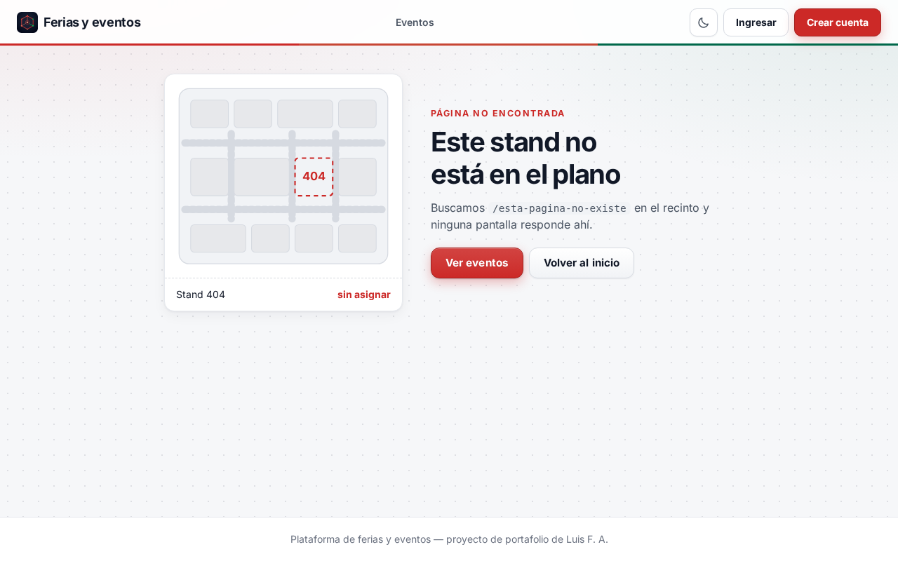 | 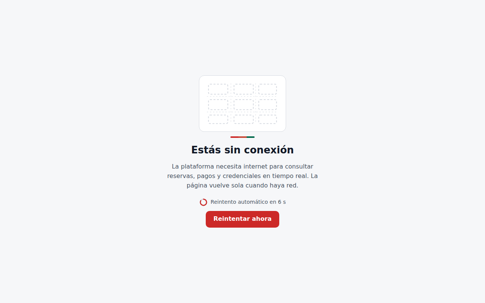 |

## 11. Preguntas frecuentes

**¿Por qué la primera carga tarda?** Los servicios se suspenden cuando nadie los usa y despiertan
con la primera visita.

**No me llegó el código por correo.** Revisa la carpeta de spam y pide uno nuevo.

**Mi reserva desapareció.** Venció sin pagarse: el stand volvió a quedar disponible.

**No me llegan avisos a Telegram.** Vincúlalo en **Mi cuenta → Avisos por Telegram**; los avisos
siempre llegan también al correo.

**¿Se puede instalar como aplicación?** Sí: en Chrome o Edge, **Instalar aplicación**; en iPhone,
Safari → **Compartir → Agregar a inicio**.

**¿Dónde pido ayuda o reporto un problema?** Telegram [@lfac6](https://t.me/lfac6), WhatsApp
[@carraian160](https://wa.me/carraian160) o [ariascluisf@hotmail.com](mailto:ariascluisf@hotmail.com).

## 12. Glosario

| Término | Qué significa |
|---|---|
| **Agenda B2B** | Citas de negocios entre visitantes y expositores |
| **Aforo** | Número máximo de personas que admite el evento |
| **Expositor** | Empresa o persona que reserva un stand para mostrar sus productos |
| **Pabellón** | Edificio del recinto donde están los stands |
| **Stand** | Espacio del pabellón que se reserva para exponer |
| **Verificación en dos pasos** | Además de la contraseña, se pide un código que solo tú puedes recibir |
