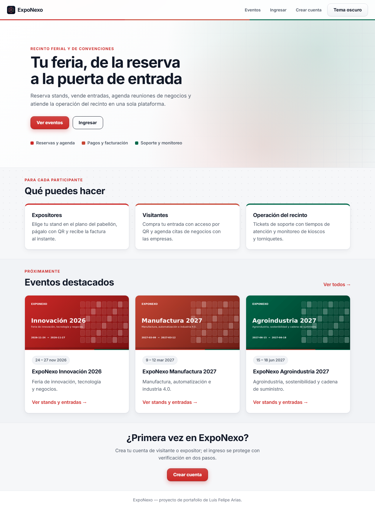
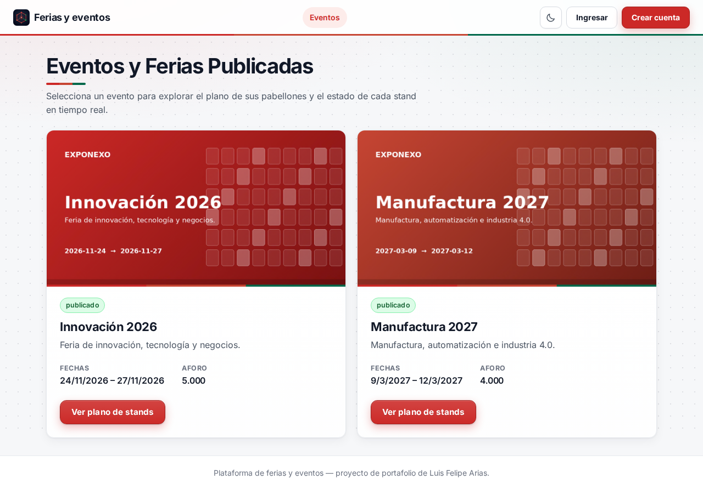
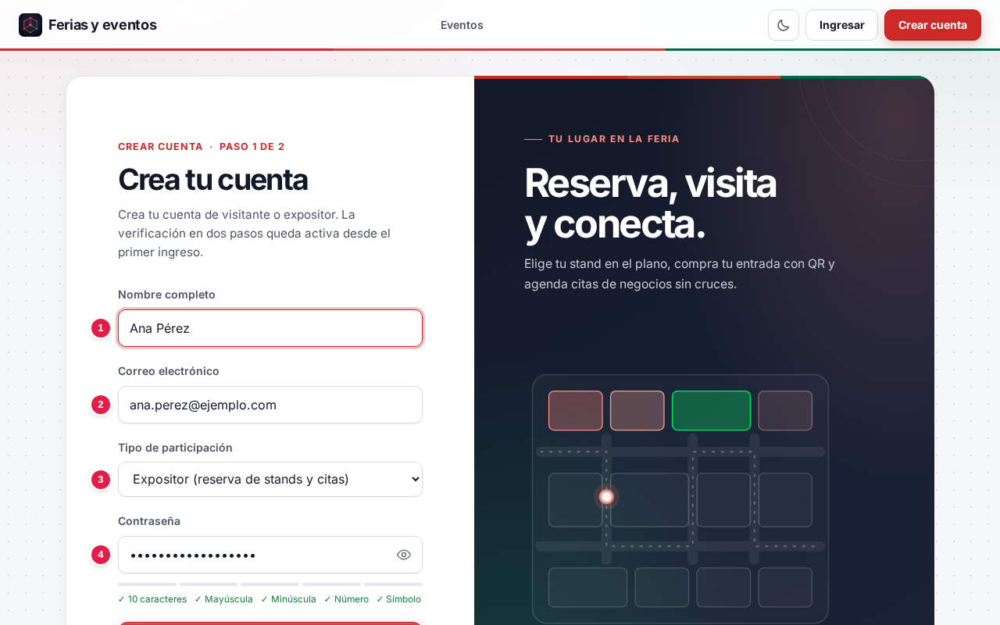
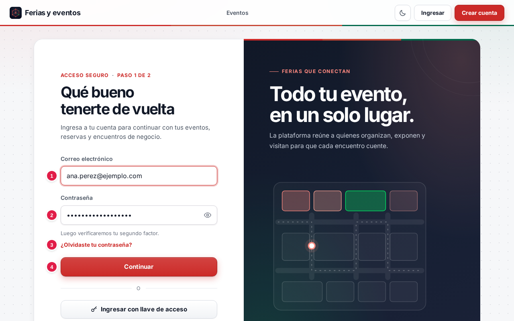
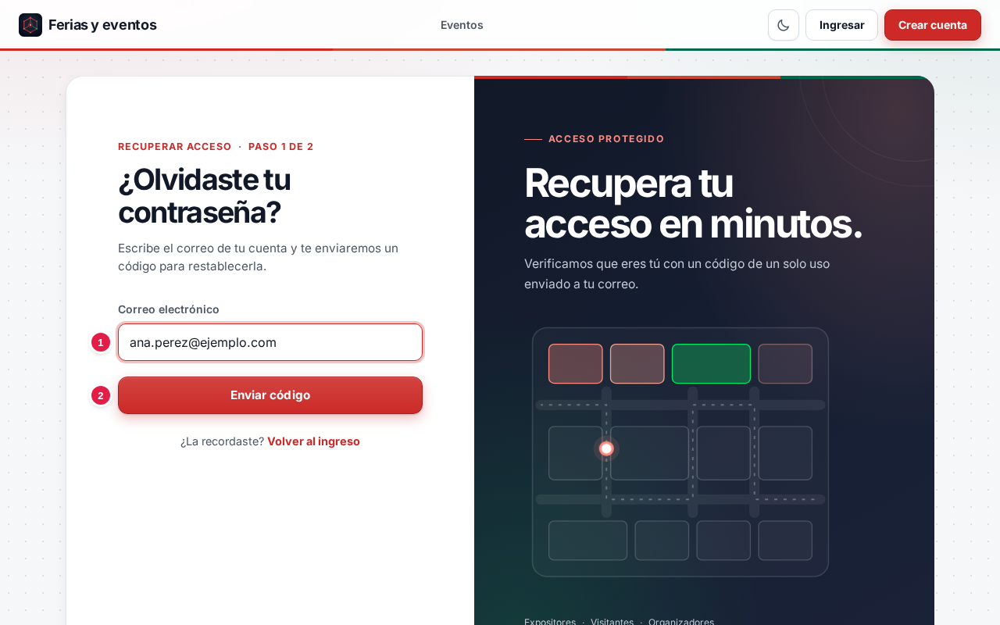
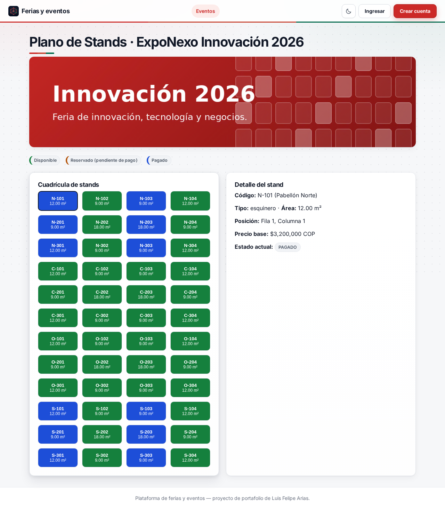
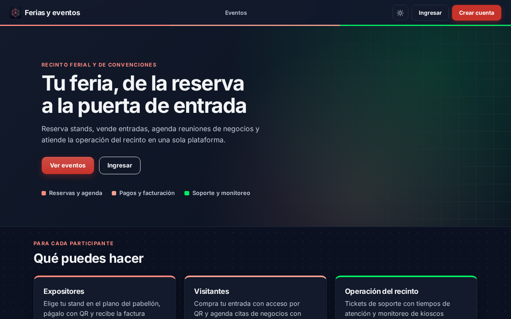

# 📘 Manual de usuario · ExpoNexo

Guía para usar la plataforma paso a paso: qué significa cada campo, qué datos se ingresan y qué
protege la plataforma. Para la parte técnica vuelve al [README](../README.md).

**Demo:** [ExpoNexo (Vercel)](https://exponexo-portal.vercel.app)

## Contenido

1. [Proyecto: objetivos y alcances](#1-proyecto-objetivos-y-alcances)
2. [Glosario](#2-glosario)
3. [Plataformas, base de datos y servicios](#3-plataformas-base-de-datos-y-servicios)
4. [Paso a paso](#4-paso-a-paso)
5. [Seguridad: tu información protegida](#5-seguridad-tu-información-protegida)
6. [Agradecimientos](#6-agradecimientos)

---

## 1. Proyecto: objetivos y alcances

### Objetivo

Es la plataforma de un recinto de ferias y eventos. Cada persona ve lo que le corresponde según su
rol:

```
Visitante → entrada con QR → agenda de citas de negocios
Expositor → stand en el plano → pago con QR → factura
Personal  → validación en la puerta → tickets de soporte → monitoreo de dispositivos
```

### Alcance: qué necesitas y qué esperar

- Solo necesitas un navegador; también se puede instalar como aplicación (opción *Instalar* o
  *Agregar a la pantalla de inicio*).
- El catálogo trae eventos, pabellones, stands y empresas de demostración para que veas cómo
  funciona desde el primer momento.
- La primera consulta del día puede tardar unos segundos: los servicios se apagan solos sin uso y
  despiertan con la primera visita. Si tardan demasiado verás la pantalla de mantenimiento, que
  se recupera sola.

### Límites

Es una demo de portafolio:

- Los pagos son simulados: no se cobra dinero real.
- No escribas datos personales o confidenciales en reservas, citas ni tickets.
- El registro público solo crea cuentas de **visitante** o **expositor**; las de personal y
  administración las crea la plataforma.

## 2. Glosario

| Término | Qué significa |
|---|---|
| **Stand** | Espacio que un expositor alquila dentro de un pabellón: básico, esquinero o isla. |
| **Pabellón** | Edificio del recinto con su plano de stands y sus salas de reunión. |
| **Reserva** | Apartado de un stand mientras se paga; si vence sin pagarse, el stand vuelve a quedar libre. |
| **Código QR** | Imagen que se lee con la cámara: la usan las entradas y los cobros, y está firmada para que no se pueda falsificar. |
| **Cita de negocios (B2B)** | Reunión agendada entre un visitante y un expositor en una sala libre. |
| **Ticket** | Solicitud de soporte del recinto (red, energía, mobiliario, acceso, dispositivos). |
| **SLA** | Tiempo máximo comprometido para atender un ticket según su prioridad. |
| **Verificación en dos pasos (MFA)** | Además de la contraseña, se pide un código de tu app autenticadora o de tu correo. |
| **Llave de acceso** | Ingreso con la huella, el rostro o el PIN del dispositivo, sin contraseña. |
| **Vincular Telegram** | Conectar tu chat de Telegram con tu cuenta para recibir ahí tus avisos. |
| **API** | Puerta de entrada de un programa para que otros programas le pidan o le envíen datos. |
| **Modo mantenimiento** | Pantalla que aparece cuando un servicio no responde; se recupera sola cuando vuelve. |

## 3. Plataformas, base de datos y servicios

| Parte | Nube | Base de datos | Qué hace |
|---|---|---|---|
| Portal | Vercel | — | Las pantallas que ves |
| Identidad y reservas | Azure Container Apps | Azure SQL | Cuentas, verificación en dos pasos, catálogo, reservas, entradas y agenda |
| Pagos | Google Cloud Run | Oracle Autonomous | Órdenes, cobro con QR y facturas |
| Mesa de ayuda | Azure Container Apps | MongoDB Atlas | Tickets con SLA y monitoreo de dispositivos |
| Avisos | AWS Lambda | Azure SQL (destinatarios) | Correo (Brevo) y Telegram a la persona afectada |
| Imágenes | Cloudinary | — | Portadas de eventos, logos y planos |

## 4. Paso a paso

### 4.1 Portada y eventos



La portada presenta el recinto y los próximos eventos. **Ver eventos** abre el catálogo con las
ferias publicadas, sus fechas y su aforo.



### 4.2 Crear una cuenta



| # | Campo | Qué escribir | Reglas |
|:-:|---|---|---|
| 1 | Nombre completo | Tu nombre | Obligatorio |
| 2 | Correo electrónico | El correo con el que vas a entrar | Formato válido y único |
| 3 | Tipo de participación | Visitante o expositor | El personal y la administración no se piden aquí |
| 4 | Contraseña | Tu contraseña | Mínimo **10 caracteres** con mayúscula, minúscula, número y símbolo |
| 5 | Registrarme | Botón | Crea la cuenta y envía un código a tu correo para confirmarlo |

### 4.3 Iniciar sesión



| # | Campo | Qué escribir |
|:-:|---|---|
| 1 | Correo electrónico | El correo de tu cuenta |
| 2 | Contraseña | Tu contraseña (el ojo la muestra u oculta) |
| 3 | ¿Olvidaste tu contraseña? | Abre la recuperación con código por correo (ver 4.4) |
| 4 | Continuar | Pasa al segundo paso: código de tu app autenticadora, código por correo o código de respaldo |

También puedes pulsar **Ingresar con llave de acceso** para entrar con la huella, el rostro o el PIN
del dispositivo, si ya registraste una llave en **Mi cuenta**.

### 4.4 Recuperar la contraseña



| # | Campo | Qué escribir |
|:-:|---|---|
| 1 | Correo electrónico | El correo de tu cuenta |
| 2 | Enviar código | Envía un código de un solo uso a tu correo; la respuesta es la misma exista o no la cuenta |

En el segundo paso escribes el **código**, la **nueva contraseña** (con el medidor de reglas) y su
**confirmación**. Al restablecerla se cierran todas tus sesiones y te llega un aviso por correo y
Telegram. El código vence en pocos minutos y deja de servir tras varios intentos fallidos.

### 4.5 Mi cuenta

Con la sesión iniciada, pulsa tu nombre en la esquina superior derecha:

- **Datos:** nombre, rol, correo, estado de Telegram y de la verificación en dos pasos.
- **Cambiar contraseña:** pide la actual y la nueva; cierra tus sesiones en otros dispositivos.
- **Avisos por Telegram:** pulsa **Vincular Telegram**, pulsa **Iniciar** en el bot de ExpoNexo y
  vuelve con **Ya pulsé Iniciar**. Desde ahí tus avisos llegan por correo y por Telegram.
- **App autenticadora:** escanea el QR y escribe el primer código; queda como método por defecto.
- **Código por correo y respaldo:** elige el método por defecto y genera códigos de respaldo.
- **Llaves de acceso** y **sesiones activas**.

### 4.6 Plano de stands (expositores)



1. En **Eventos**, pulsa **Ver plano de stands**.
2. Los colores muestran el estado: **verde** disponible, **naranja** reservado pendiente de pago y
   **azul** pagado.
3. Al elegir un stand ves su código, tipo, área, posición y precio; si está disponible y entraste como expositor, pulsa
   **Reservar este stand**.
4. En **Mis Reservas** pulsa **Pagar con QR**: se genera un QR de cobro con vigencia corta. Al aprobarse
   el pago la reserva queda pagada y la factura aparece en **Facturas**.

### 4.7 Entradas y agenda de negocios (visitantes)

- En **Mis Entradas → Adquirir nueva entrada** elige el evento y el tipo, y pulsa **Pagar y activar QR**; ya pagada aparece con su QR de acceso.
- En **Agenda B2B** busca expositores, revisa sus horarios libres y pide una cita. Cuando el
  expositor la acepta, el sistema asigna una sala libre y avisa a ambos.

### 4.8 Operación del recinto (personal)

- **Validar QR en puerta**: lee la entrada en la puerta; una entrada usada o alterada se rechaza.
- **Mesa de ayuda**: crea y atiende tickets; cada prioridad tiene su tiempo de atención y un ticket
  vencido se escala.
- **Dispositivos**: estado de kioscos, torniquetes y pantallas; si uno deja de reportar se abre un
  ticket automáticamente.

### 4.9 Administración

- **Catálogo**: crea y edita eventos, pabellones, stands y salas.
- **Tablero**: ocupación de stands, recaudo, entradas vendidas y estado del soporte.

### 4.10 Tema claro y oscuro



El botón con la luna o el sol, junto a **Ingresar**, cambia los colores y se recuerda en las siguientes visitas.

### 4.11 Preguntas frecuentes

- **¿Por qué la primera carga tarda?** Los servicios duermen sin uso para no generar costos;
  despiertan con la primera visita.
- **No me llegó el código por correo.** Revisa la carpeta de spam y pide uno nuevo desde el
  segundo paso.
- **Mi reserva desapareció.** Venció sin pagarse: el stand volvió a quedar disponible.
- **No me llegan avisos a Telegram.** Vincúlalo en **Mi cuenta → Avisos por Telegram**; los avisos
  siempre llegan también al correo.

## 5. Seguridad: tu información protegida

### Qué datos se guardan y dónde

| Dato | Dónde | Cómo |
|---|---|---|
| Correo, nombre y rol | Azure SQL | En la cuenta |
| Chat de Telegram | Azure SQL | Solo si lo vinculas; puedes desvincularlo cuando quieras |
| Contraseña | Azure SQL | Solo como huella; no se puede recuperar el texto original |
| Secreto de la app autenticadora | Azure SQL | Cifrado |
| Reservas, entradas y citas | Azure SQL | Asociadas a tu cuenta |
| Órdenes y facturas | Oracle | Asociadas a tu cuenta |
| Tickets | MongoDB | Con su historial |

### Cómo se protege tu información

- Verificación en dos pasos obligatoria y llaves de acceso del dispositivo.
- Bloqueo temporal ante intentos fallidos repetidos y registro de eventos de seguridad, depurado a
  los 15 días.
- Las sesiones usan tokens firmados que cada servicio verifica; las rutas internas solo aceptan
  servicios autorizados.
- Los códigos QR de entradas y cobros están firmados: uno alterado se rechaza.
- Cambiar o restablecer la contraseña cierra las demás sesiones y te avisa por correo y Telegram.
- Los avisos van solo a la persona afectada y nunca incluyen contraseñas, códigos ni tokens.

## 6. Agradecimientos

A las comunidades de FastAPI, Spring, .NET, React y a los planes gratuitos de Vercel, Azure,
Google Cloud, AWS, Oracle Cloud, MongoDB Atlas, Brevo y Cloudinary que hacen posible el proyecto.
